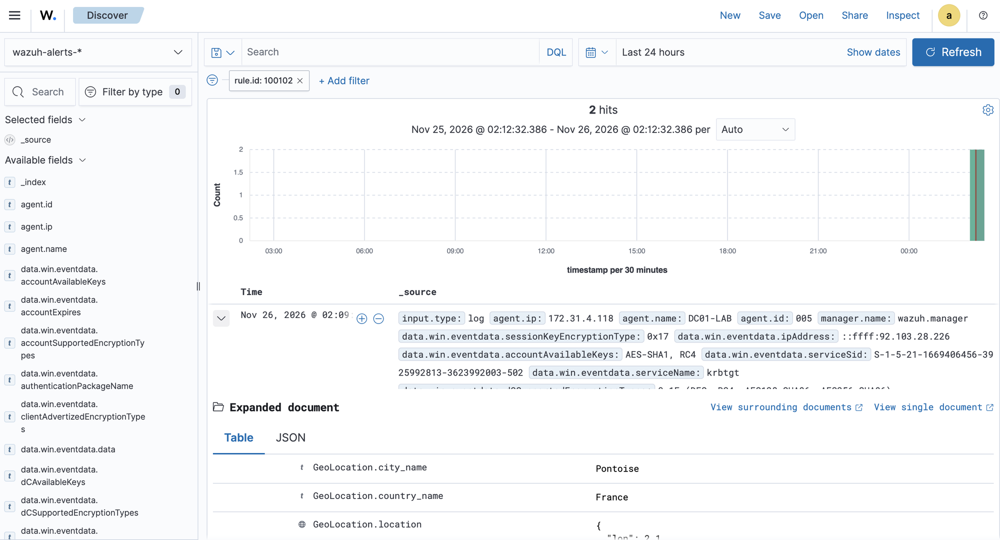

# AS-REP Roasting : attaque et détection (Event 4768)

> Deuxième ligne de mon catalogue, après le [Kerberoasting](./kerberoasting-detection.md).
> Lab jetable, identifiants sans valeur.

## L'attaque

Normalement, un compte prouve son mot de passe pour obtenir un TGT (la pré-authentification).
Si le flag `DONT_REQ_PREAUTH` est posé, le KDC donne le ticket **sans preuve**. Une partie du
ticket est chiffrée avec la clé du mot de passe : on la casse hors ligne.

Différence avec le Kerberoasting : **aucun compte valide n'est requis**, juste un nom.

```bash
impacket-GetNPUsers lab.local/svc_legacy -no-pass -dc-ip <IP_DC>
```

`-no-pass` : je n'envoie aucune authentification. Je récupère un hash `$krb5asrep$23$`, cassé
avec John et rockyou (`Welcome1`).


MITRE : [T1558.004](https://attack.mitre.org/techniques/T1558/004/).

## Le signal

Trace sur le DC : **Event 4768** (un TGT a été demandé). Le champ qui compte :

| `preAuthType` | Sens |
|---|---|
| `2` | pré-auth normale (le mot de passe a été prouvé) |
| `0` | **aucune pré-auth** = compte roastable |

Détection = **4768 avec `preAuthType = 0`**.

## Le piège du RC4

Réflexe du Kerberoasting : filtrer sur le RC4. Faux ici. Sur le vrai event :

- `ticketEncryptionType = 0x12` (AES, le TGT chiffré par krbtgt).
- `sessionKeyEncryptionType = 0x17` (RC4, la partie roastable).

Filtrer sur le RC4 (`ticketEncryptionType`) n'aurait rien matché. Le bon signal, c'est l'absence
de pré-auth.



## La règle

```xml
<rule id="100102" level="10">
  <if_sid>60103</if_sid>
  <field name="win.system.eventID">^4768$</field>
  <field name="win.eventdata.preAuthType">^0$</field>
  <description>Possible AS-REP Roasting: TGT 4768 sans pre-authentification pour $(win.eventdata.targetUserName)</description>
  <mitre>
    <id>T1558.004</id>
  </mitre>
</rule>
```

`if_sid 60103` = la règle parente du journal Security. Sans le bon parent, la règle ne s'évalue
jamais.

## Validation

```
Rule: 100102 (level 10) -> 'Possible AS-REP Roasting: TGT 4768 sans pre-authentification pour svc_legacy'
```

Alerte visible dans le dashboard, mappée T1558.004 / Credential Access.

## Bonus

Activer `DONT_REQ_PREAUTH` sur un compte génère un **Event 4738** (`'Don't Require Preauth' -
Enabled`). Le détecter attrape la mise en place, avant même l'attaque.

## Faux positifs et durcissement

- Un compte sans pré-auth est rare et reste une mauvaise config. À corriger, pas à ignorer.
- Audit : `Get-ADUser -Filter {DoesNotRequirePreAuth -eq $true}`.
- Retirer le flag, mots de passe longs et aléatoires.

## Références

- [Kerberoasting](./kerberoasting-detection.md)
- MITRE [T1558.004](https://attack.mitre.org/techniques/T1558/004/)
