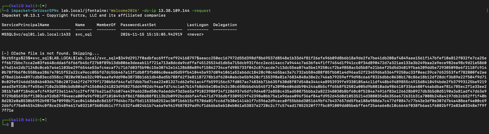
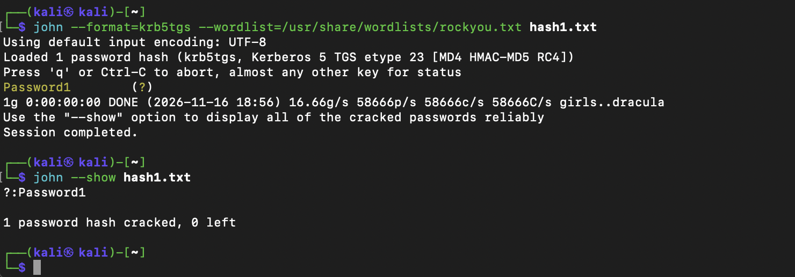
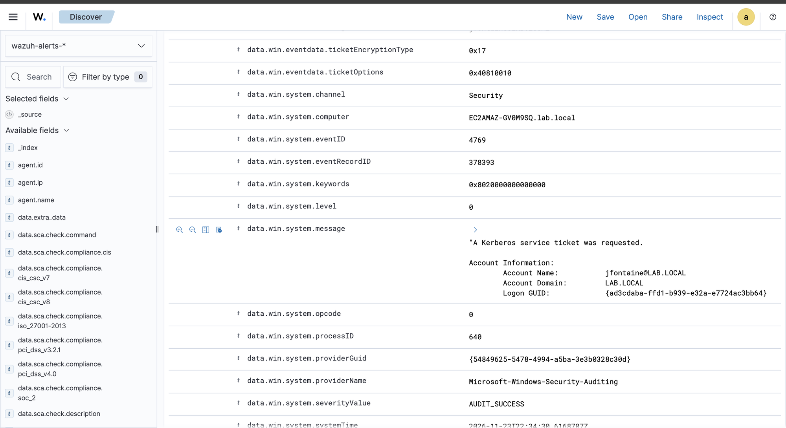
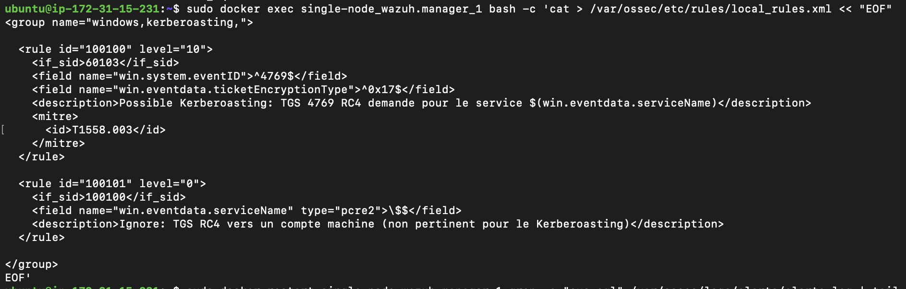
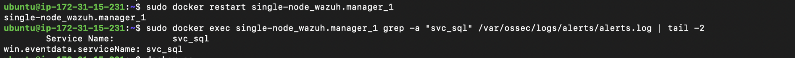

# Kerberoasting : attaque et détection (Event 4769)

> Première ligne de mon catalogue Identity Attack vers Detection.
> Lab jetable, identifiants sans valeur.

## L'attaque

N'importe quel utilisateur authentifié peut demander un TGS pour un SPN. Le ticket est chiffré avec
la clé du compte de service : on le casse hors ligne. Aucune faille, juste un abus de Kerberos et un
mot de passe de service faible.

Pré-requis : un compte de domaine, même sans privilège (`jfontaine`), et un compte de service avec un
SPN (`svc_sql`, `MSSQLSvc/sql01.lab.local`).

```bash
impacket-GetUserSPNs lab.local/jfontaine:'Welcome2026' -dc-ip <IP_DC> -request
```

Sort un hash `$krb5tgs$23$` (`23` = RC4), cassé avec John et rockyou (`Password1`).




MITRE : [T1558.003](https://attack.mitre.org/techniques/T1558/003/).

## Le signal

Seule trace sur le DC : **Event 4769** (TGS demandé), journal Security. Un DC en génère en masse, donc
alerter sur « tout 4769 » est inutile. Ce qui sépare l'attaque du bruit, c'est le **chiffrement** :

| Trafic | `ticketEncryptionType` |
|---|---|
| Normal (comptes machine, krbtgt) | `0x12` (AES256) |
| Attaque | `0x17` (RC4) |

Windows utilise l'AES par défaut. Les outils demandent du RC4 exprès, parce qu'il se casse plus vite.
Un 4769 en RC4 sur un compte de service détonne.



## La règle

```xml
<rule id="100100" level="10">
  <if_sid>60103</if_sid>
  <field name="win.system.eventID">^4769$</field>
  <field name="win.eventdata.ticketEncryptionType">^0x17$</field>
  <description>Possible Kerberoasting: TGS 4769 RC4 demande pour le service $(win.eventdata.serviceName)</description>
  <mitre>
    <id>T1558.003</id>
  </mitre>
</rule>

<rule id="100101" level="0">
  <if_sid>100100</if_sid>
  <field name="win.eventdata.serviceName" type="pcre2">\$$</field>
  <description>Ignore: TGS RC4 vers un compte machine</description>
</rule>
```

- `if_sid 60103` = la règle parente du journal Security. Sans le bon parent, la règle ne s'évalue
  jamais.
- `0x17` = RC4, le filtre qui fait tout.
- `100101` : règle enfant en niveau 0, qui étouffe le bruit des comptes machine (nom finissant par
  `$`), jamais concernés par le Kerberoasting.



## Les pièges

Trois choses m'ont bloqué, et c'est ce qui vaut le plus :

1. **Mauvais parent.** J'avais `if_sid 60000` (base de *tous* les events Windows). Il fallait `60103`
   (journal Security). Avec le mauvais parent, la règle ne matche jamais, en silence.
2. **La constante du blog.** Le guide officiel Wazuh filtre sur `ticketOptions 0x40810000`. Mon vrai
   event montrait `0x40810010`. Copier la règle telle quelle = elle ne matche rien. On valide contre sa
   propre télémétrie, pas contre un blog.
3. **ID en double.** Deux règles `100100` dans deux fichiers = Wazuh rejette le doublon. Un ID doit
   être unique.

## Validation

```
Rule: 100100 (level 10) -> 'Possible Kerberoasting: TGS 4769 RC4 pour le service svc_sql'
```

Décodeur `windows_eventchannel`, service `svc_sql`, chiffrement `0x17`. Alerte visible dans le
dashboard.



## Faux positifs et durcissement

- RC4 légitime possible en domaine mixte (vieux comptes ou applis). Liste blanche si besoin, mais le
  vrai réflexe est de les corriger.
- Comptes machine exclus par la règle `100101`.
- Durcissement : forcer l'AES, mots de passe longs ou **gMSA** (120 caractères gérés par l'AD, donc
  incassables). Ma détection RC4 attrape l'attaque **et** la dette technique.

## Bilan

```
attaque (TGS RC4)  ->  telemetrie (Event 4769, 0x17)  ->  regle Wazuh validee  ->  durcissement
```

MITRE ATT&CK : [T1558.003](https://attack.mitre.org/techniques/T1558/003/).

## Références

- MITRE [T1558.003](https://attack.mitre.org/techniques/T1558/003/).
