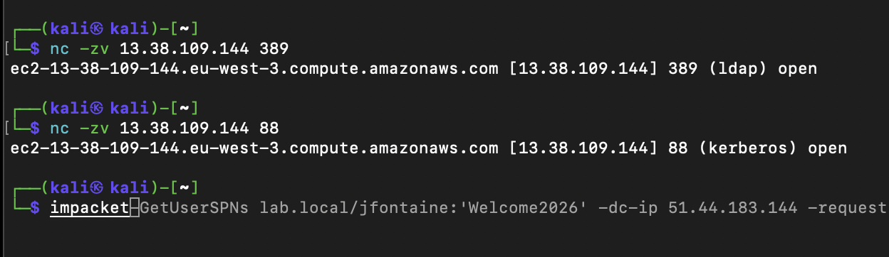
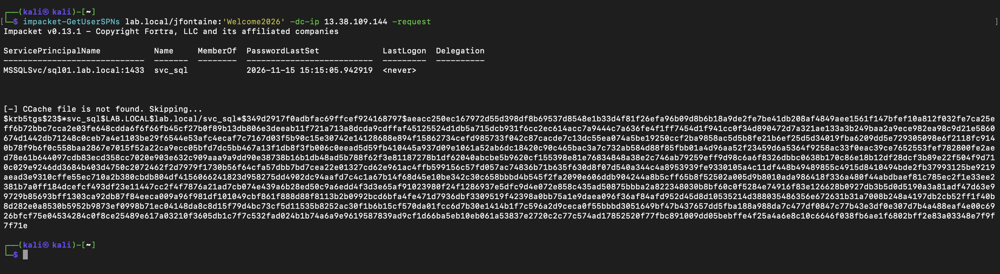
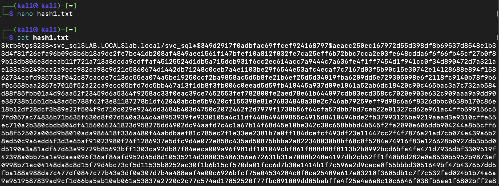
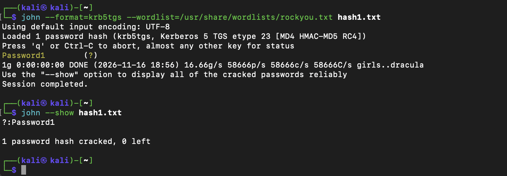

# Kerberoasting : lab hands-on (`lab.local`)

> Writeup pratique de l'attaque Kerberoasting, réalisée de bout en bout sur mon propre
> lab AD. Complète la théorie de [`ad-attacks-cheatsheet.md`](./ad-attacks-cheatsheet.md).
> Fil rouge du repo : comprendre l'attaque pour savoir la détecter et la durcir.
>
> ⚠️ Lab jetable. Le compte, le mot de passe (`Password1`) et le hash montrés ici sont
> volontairement faibles et sans valeur. En mission réelle, on ne publie jamais un hash
> ou un identifiant capturé.

---

## 1. Contexte & objectif

Mon objectif est d'obtenir le mot de passe d'un compte de service du domaine en partant
d'un simple compte utilisateur, sans jamais toucher au contrôleur de domaine. J'en déduis
ensuite ce qu'un défenseur doit voir dans ses logs pour repérer l'attaque.

Voici le lab :

```
┌─────────────────────────────┐          Internet          ┌──────────────────────────────┐
│  Kali (attaquant)           │   ───────────────────────► │  DC01 : Windows Server 2022   │
│  VM VirtualBox (NAT)        │   ports 88 (Kerberos)       │  EC2 (AWS eu-west-3)          │
│  impacket, John the Ripper  │   + 389 (LDAP)              │  domaine lab.local            │
└─────────────────────────────┘   ouverts à mon IP dans    │  KDC + DNS                    │
                                   le Security Group        └──────────────────────────────┘
```

La cible DC01 est le contrôleur de domaine `lab.local`, hébergé sur EC2. C'est lui le KDC,
donc c'est lui qui émet les tickets Kerberos. Je l'attaque sur son IP publique. L'attaquant
est une VM Kali locale sur un Mac, en NAT, qui joint le DC par Internet.

Côté réseau, seuls les ports 88 (Kerberos) et 389 (LDAP) sont ouverts, et uniquement vers
mon IP dans le Security Group AWS, jamais vers `0.0.0.0/0`. C'est le strict minimum pour le
Kerberoasting.

Ce scénario est réaliste parce que le Kerberoasting n'exploite aucune faille logicielle. Il
détourne un fonctionnement légitime de Kerberos : n'importe quel utilisateur authentifié a
le droit de demander un ticket de service. La seule vraie faiblesse exploitée est humaine,
c'est le mot de passe trop faible du compte de service. Comprendre cette attaque, c'est donc
surtout apprendre à la repérer dans les journaux et à la rendre inutile par du durcissement.

Technique MITRE ATT&CK associée : [T1558.003, Kerberoasting](https://attack.mitre.org/techniques/T1558/003/).

---

## 2. Pré-requis

Le Kerberoasting repose sur deux éléments, pas un de plus.

**Un compte de domaine valide, même sans aucun privilège.** Ici j'utilise `jfontaine`
(mot de passe `Welcome2026`), un utilisateur lambda. Il ne me sert qu'à m'authentifier
auprès de Kerberos, c'est à dire à avoir le droit de demander des tickets. C'est mon point
d'entrée, celui qu'un attaquant obtient en général par phishing ou par des identifiants
déjà volés.

**Un compte de service qui possède un SPN.** Ici c'est `svc_sql`, avec le SPN
`MSSQLSvc/sql01.lab.local:1433`. Un SPN (Service Principal Name) est l'étiquette qui dit
« ce compte fait tourner tel service, à telle adresse ». C'est elle qui rend le compte
attaquable, pour une raison précise détaillée à l'étape 2 : le ticket de service est
chiffré avec la clé de ce compte.

Deux points à bien garder en tête :

- On vise un SPN posé sur un compte **utilisateur**, pas sur un compte d'ordinateur. Les
  comptes machine ont presque tous un SPN, mais leur mot de passe est généré aléatoirement
  sur 120 caractères et change tout seul, donc il est incassable. Seul un compte de service
  avec un mot de passe choisi par un humain est une cible utile.
- Sans SPN, pas de Kerberoasting. S'il n'y a rien à demander, il n'y a aucun ticket chiffré
  à récupérer, donc aucun hash à casser. C'est d'ailleurs une des parades : retirer les SPN
  inutiles.

Côté lab, j'avais préparé `svc_sql` au préalable avec un mot de passe volontairement faible,
puis je lui avais attribué son SPN avec `setspn -s MSSQLSvc/sql01.lab.local:1433 svc_sql`.

---

## 3. Étape 1 : repérage réseau

Avant de lancer quoi que ce soit, je vérifie que ma Kali atteint bien le DC sur les ports
dont j'ai besoin. Ça évite de perdre du temps : si l'attaque échoue plus tard alors que les
ports répondent, je saurai que le problème n'est pas le réseau mais l'authentification ou
Kerberos.

```bash
nc -zv <IP_DC> 389
nc -zv <IP_DC> 88
```

`nc` c'est netcat, le couteau suisse réseau. L'option `-z` le met en mode scan, il teste
juste si le port est ouvert sans envoyer de données. L'option `-v` le rend verbeux pour
qu'il m'affiche le résultat.

Je teste deux ports précis, parce que ce sont les deux dont le Kerberoasting a besoin :

- **389 (LDAP)** sert à l'énumération. C'est par là que je vais demander au DC la liste des
  comptes qui ont un SPN.
- **88 (Kerberos)** sert à la demande du ticket. C'est par là que je récupère le TGS chiffré
  avec la clé du compte de service.



Les deux ports répondent `open`, le réseau est bon.

À noter, visible sur la capture : j'ai d'abord tapé la commande d'attaque avec une ancienne
IP publique du DC. Sur EC2, l'IP publique change à chaque arrêt puis redémarrage de
l'instance, sauf si on attache une Elastic IP. Je l'ai corrigée avec la bonne IP juste
après. Petit détail, mais c'est le genre d'erreur qui fait croire à tort que l'attaque ne
marche pas.

---

## 4. Étape 2 : énumération et demande du TGS

Une seule commande fait tout le travail, avec l'outil `GetUserSPNs` d'impacket :

```bash
impacket-GetUserSPNs lab.local/jfontaine:'Welcome2026' -dc-ip <IP_DC> -request
```

Décorticage :

- `lab.local/jfontaine:'Welcome2026'` sont mes identifiants, au format
  `domaine/utilisateur:motdepasse`. C'est mon compte lambda, mon point d'entrée.
- `-dc-ip <IP_DC>` indique l'adresse du contrôleur de domaine. Je la précise pour éviter
  toute résolution DNS, puisque ma Kali ne connaît pas le DNS interne du domaine.
- `-request` est le mot clé important. Sans lui, l'outil se contente de lister les comptes
  qui ont un SPN. Avec lui, il demande en plus les tickets et affiche les hashs à casser.

Ce qui se passe réellement se fait en deux temps.

**D'abord l'énumération, sur le port 389 (LDAP).** L'outil se connecte avec mon compte
`jfontaine` et demande au DC la liste des comptes utilisateurs qui ont un SPN. Le DC répond
`svc_sql`. En interne, c'est une requête LDAP du genre
`(&(samAccountType=805306368)(servicePrincipalName=*))`, ce qui veut dire « les objets de
type utilisateur qui ont au moins un SPN ».

**Ensuite la demande du ticket, sur le port 88 (Kerberos).** L'outil demande au DC un ticket
de service (un TGS) pour le SPN de `svc_sql`. Et voici le point central de toute l'attaque :
le DC chiffre ce ticket avec la clé du compte de service, c'est à dire avec une clé dérivée
du mot de passe de `svc_sql`. En temps normal, c'est le service SQL lui même qui devra
déchiffrer ce ticket pour accepter la connexion, donc seul lui est censé pouvoir le lire.

Le détournement est là : n'importe quel utilisateur authentifié peut demander ce ticket, le
DC ne vérifie aucun droit. Je récupère donc un bloc de données chiffré avec le secret d'un
compte que je ne connais pas, et je vais pouvoir l'attaquer tranquillement hors ligne.



La sortie affiche d'abord un tableau avec `svc_sql` et son SPN, puis le hash du ticket, une
longue chaîne qui commence par `$krb5tgs$23$`. C'est lui que je vais casser.

---

## 5. Étape 3 : extraction du hash

Je copie le hash dans un fichier, pour pouvoir le passer à mon outil de cassage. J'ouvre un
fichier avec `nano`, j'y colle uniquement la ligne qui commence par `$krb5tgs$`, puis je
vérifie qu'il n'y a bien qu'une seule ligne :

```bash
nano hash1.txt
cat hash1.txt
```



Le hash n'est pas une bouillie aléatoire, il est structuré. En lisant son début, je sais
déjà à quoi j'ai affaire :

```
$krb5tgs$23$*svc_sql$LAB.LOCAL$...<données chiffrées>...
```

- `krb5tgs` dit que c'est un ticket de service Kerberos (un TGS).
- `23` est le type de chiffrement du ticket. Le 23 correspond au **RC4-HMAC**, l'ancien
  algorithme de Kerberos, rapide à calculer donc rapide à casser.
- `svc_sql` et `LAB.LOCAL` rappellent le compte ciblé et le domaine.
- Le reste est la partie chiffrée, celle que je vais attaquer par force brute hors ligne.

Ce `23` est une information précieuse pour la suite. C'est lui qui me dira quel mode utiliser
dans l'outil de cassage, et c'est aussi lui qui explique que l'attaque sera quasi instantanée
plutôt que longue. Un ticket chiffré en AES aurait un numéro différent et serait beaucoup
plus lent à attaquer. J'y reviens à la section 7, parce que ce détail m'a justement posé un
problème au début du lab.

---

## 6. Étape 4 : cassage hors ligne

Maintenant que j'ai le hash dans un fichier, je le casse avec John the Ripper et la wordlist
`rockyou`, le dictionnaire classique de mots de passe courants :

```bash
john --format=krb5tgs --wordlist=/usr/share/wordlists/rockyou.txt hash1.txt
john --show hash1.txt
```

John charge le hash, le reconnaît comme un `krb5tgs` en RC4, puis teste chaque mot de la
liste. Pour chaque candidat, il dérive une clé et tente de déchiffrer le ticket. Quand le
déchiffrement est cohérent, c'est qu'il a trouvé le bon mot de passe.



Résultat, le mot de passe de `svc_sql` est `Password1`, trouvé en moins d'une seconde. John
mémorise les hashs déjà cassés dans `~/.john/john.pot`, donc `john --show` le réaffiche sans
refaire le calcul.

Deux choses méritent d'être soulignées ici.

**Pourquoi John et pas Hashcat.** J'ai d'abord tenté Hashcat, mais ma VM Kali manque de
mémoire et Hashcat s'arrêtait aussitôt sur une erreur d'allocation. John est plus léger et a
cassé le même hash sans problème. La leçon n'est pas « John est meilleur », c'est qu'il faut
savoir basculer d'outil quand l'environnement est contraint. À titre indicatif, pour rester
sur Hashcat, le mode à utiliser pour ce type de hash est `13100` (Kerberos 5 TGS, RC4).

**Pourquoi c'est hors ligne et quasi invisible.** Tout le cassage se passe sur ma Kali, sans
jamais reparler au DC. Du point de vue du contrôleur de domaine, la seule chose qu'il a vue,
c'est une demande de ticket parfaitement légitime à l'étape 2. Rien dans le cassage ne touche
le réseau. C'est exactement ce qui rend l'attaque discrète, et ça oriente directement la
défense : il n'y a rien à détecter au moment du crack, tout se joue au moment de la demande
du ticket, c'est à dire sur l'événement 4769 côté contrôleur de domaine.

Le succès instantané tient à une seule chose, le mot de passe `Password1` est dans `rockyou`.
Un mot de passe long et aléatoire aurait produit exactement le même hash, mais aucune wordlist
ni aucune force brute réaliste ne serait venue à bout. C'est toute la leçon défensive du lab.

---

## 7. Le piège RC4

L'attaque n'a pas marché du premier coup, et le déboguer m'a fait comprendre un point
important sur les types de chiffrement de Kerberos.

Au premier essai, `GetUserSPNs -request` listait bien `svc_sql` et son SPN, mais au moment de
demander le ticket, il échouait avec cette erreur :

```
KDC_ERR_ETYPE_NOSUPP (KDC has no support for encryption type)
```

En clair, le KDC refusait de fournir le ticket dans le type de chiffrement demandé. La cause
tient à une rencontre entre deux comportements. D'un côté, ma version d'impacket demande le
ticket en RC4 (le fameux type 23). De l'autre, Windows Server 2022 désactive le RC4 par
défaut pour se durcir, et mon compte `svc_sql` n'annonçait aucun type de chiffrement
particulier, donc le DC le traitait comme un compte AES uniquement. L'outil réclamait du RC4,
le compte ne proposait que de l'AES, les deux ne se mettaient pas d'accord.

Pour mon lab, j'ai configuré `svc_sql` pour qu'il accepte explicitement le RC4, puis j'ai
réinitialisé son mot de passe pour que la clé RC4 soit effectivement générée. Après ça, la
demande de ticket a fonctionné et j'ai obtenu mon hash en `$krb5tgs$23$`.

Ce n'est pas une triche de lab, c'est même très réaliste. Beaucoup de comptes de service en
entreprise sont restés configurés en RC4 pour de vieilles raisons de compatibilité, et ce
sont précisément les cibles les plus faciles du Kerberoasting. Forcer l'AES et abandonner le
RC4 fait d'ailleurs partie des mesures de durcissement.

Le type de chiffrement du ticket détermine directement l'outil et la vitesse de cassage :

| Type dans le hash | Chiffrement | Mode Hashcat | Vitesse de cassage |
|---|---|---|---|
| `$krb5tgs$23$` | RC4-HMAC | `13100` | rapide |
| `$krb5tgs$17$` | AES128 | `19600` | lent |
| `$krb5tgs$18$` | AES256 | `19700` | très lent |

Autrement dit, le numéro qui suit `$krb5tgs$` m'indique à la fois le mode à utiliser et à quel
point le mot de passe sera difficile à retrouver. Un compte de service en RC4 avec un mot de
passe faible, c'est le pire des deux mondes côté défense, et le meilleur côté attaquant.

---

## 8. Bilan

En partant d'un simple compte utilisateur sans privilège, j'ai récupéré le mot de passe d'un
compte de service du domaine, entièrement hors ligne, sans jamais compromettre le contrôleur
de domaine. La chaîne complète :

```
compte lambda (jfontaine)
  → énumération LDAP : quel compte a un SPN ?        (svc_sql)
  → demande du TGS, chiffré avec la clé du compte     ($krb5tgs$23$)
  → cassage offline avec John + rockyou               (Password1)
```

La faille n'est pas technique, elle est humaine et organisationnelle : un mot de passe de
service trop faible, laissé en chiffrement RC4. Les deux parades principales sont un mot de
passe long et aléatoire (idéalement un **gMSA**, dont le mot de passe de 120 caractères est
géré et renouvelé par l'AD lui même) et l'abandon du RC4 au profit de l'AES.

**La suite, côté défense :** j'ai rejoué cette attaque avec mon SIEM Wazuh branché sur le DC,
capturé l'événement **4769** en chiffrement RC4 et écrit la règle de détection, validée en
direct. C'est l'objet du writeup [`kerberoasting-detection.md`](./kerberoasting-detection.md).

---

## Références

- Sean Metcalf, adsecurity.org, articles sur le Kerberoasting et les types de chiffrement Kerberos.
- HTB Academy, module *Introduction to Active Directory*.
- MITRE ATT&CK, [T1558.003 Kerberoasting](https://attack.mitre.org/techniques/T1558/003/).
